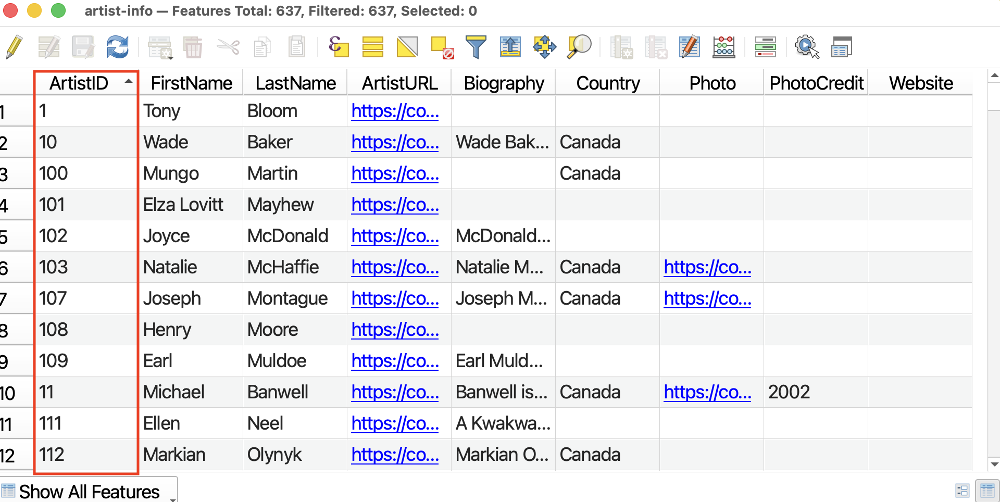
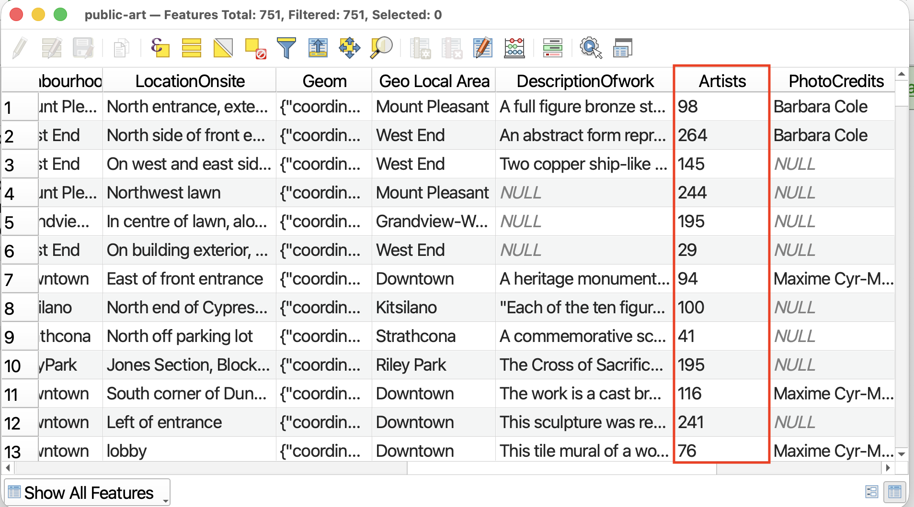
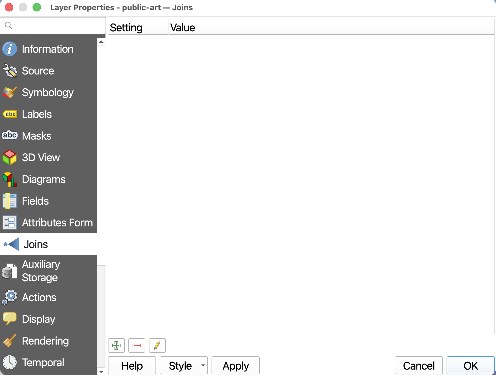
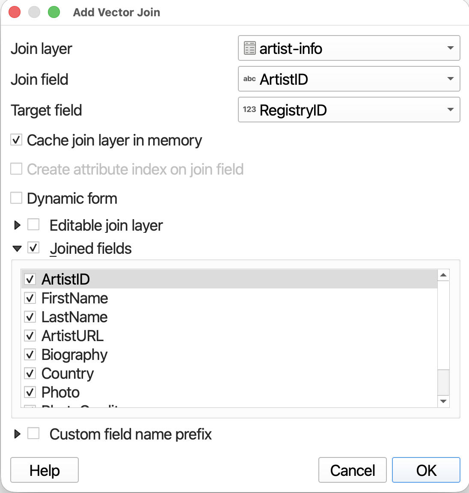
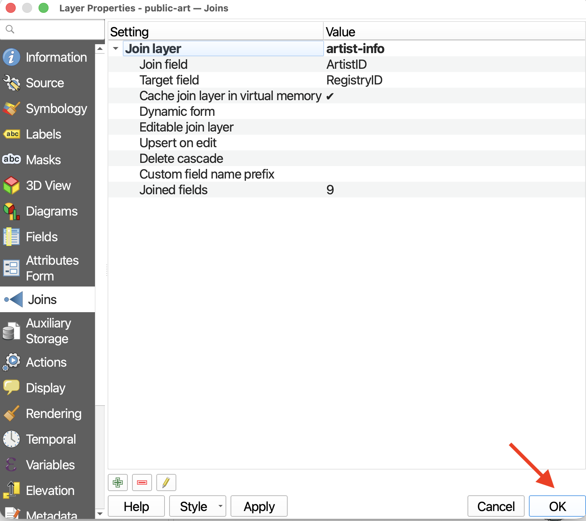

# Layer Joins
**Joins** create a connection between two layers, appending the attribute information from one layer to another. *To create a join between layers, there must be a shared field between them that matches in both values and field type. The column name need not be the same.*

Layer joins create temporary or tenuous connections in the sense that you can always remove a connection. You can think of the layers as "holding hands" for as long as you need. More permanent merging of layers can be accomplished through vector tools such as Merge Vector Layers and Intersect. These options will be discussed later on in the workshop.

----

## Create a Layer Join 

The **Target Layer** refers to your primary layer, typically a spatial layer, that you want to add more information to. The **Join Layer** is the layer that contains the additional information and it can be tabular data (like a `.csv`). 

Let's join the information on artists from the file `artist-info.csv` to our spatial layer, `public-art`. 

To Do
{: .label .label-green }

>* Turn off (hide) all layers except `city-outline` and `public-art`. 
>* Add `artist-info.csv` to your QGIS Project. Nothing will show up in the Map Canvas. 

>* Now open the Attribute Tables of both `artist-info` and `public-art`. What Field matches? Are they both formatted the same data type? If so, you can proceed. If not, see the bottom of this page. 

 

To add a join, go to the Layer Properties of the layer you want to append information *to*. This will be `public-art`

>* Open the **Properties** of `public-art` and go to the **Joins** tab. You'll see there are no current joins to this layer. Click the green plus icon to add a new join.

A new window will pop up. This window is easily lost behind other QGIS windows.

 

>* The **Join layer** will be `artist-info`
>* The **Join field**, the field of `artist-info` that matches one in `public-art`, will be `ArtistID`
>* The **Target field** will be `artists`
>* IMPORTANTLY, Check **Joined fields**. Here' you can select which fields you want to join from `artist-info`. 

 
 

 

>* Click **OK** and **OK** again to run the **Join**. 

 
 

 

>* Open the Attribute Table of `public-art` to confirm the Join was successful. You can remove a join at any time. 

 

SAVE your project. 

<!-- do something with layer now with the info...  -->

<!-- ---
#### Resources for further exploration
- [Comprehensive descriptions for all Vector Layer Properties](https://docs.qgis.org/3.44/en/docs/user_manual/working_with_vector/vector_properties.html#){:target="_blank"}
- [Working with Vector Data in QGIS](https://docs.qgis.org/3.44/en/docs/user_manual/working_with_vector/index.html){:target="_blank"} -->

<!-- show how to change field type  You'll notice many tools in toolbar, some greyed out. this is for edit mode. 

field calculator - all the things you can do. like change case etc. -->

## Changing the Field Type
If you need to change the field type there are two options. The first and more convoluted option is to edit the attribute table and run Field Calculator to update ane existing field to populate with the contents of the current field, just with a different field type. Alternatively, you can open the Field Calculator from Layer Properties -> Fields. 

<!-- if you need to more ext edit  like change to all lowercase or uppercase or something, you'll have to edit the attribute table.  -->

