# Selections 
Selections are different than using the Identify tool to highlight a feature and expose its attributes. Selections select a set of features in the Attribute Table. Once attributes are thus selected, you can edit them, export them, or perform more analysis.

There are many ways to make selections in QGIS. Broadly, you can select features **manually**, **by expression**, and spatially **by location**/**within distance**. Generally manual selections involve clicking individual features on your Map Canvas, whereas selections by expression involve using the Expression Builder within the Attribute Table. The tools to run a selection based on location/distance can be found in the Processing Toolbox. However, these last tools and all the other selection tools can be found in your **Selection Toolbar** at the top of your project window. 

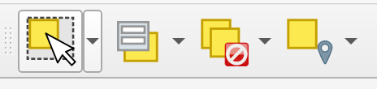

Make sure to add the Selection Toolbar to your project if not already visible. 

<!-- 
- You can select features **manually** from the Map Canvas using the Selection Toolbar

- You can select features **by expression** in the Attribute Table using the Expression Builder

- And you can select features **by location** and **within distance** using *either* the Selection Toolbar or by searching for the vector tools.  -->

---

## Manual Selections
Manually the neighbourhood of Downtown Vancouver and export it. 

>* Turn off (hide) all irrelevant layers.
>* Click the `neighborhoods` layer in your Layers Panel to ensure it is highlighted. 
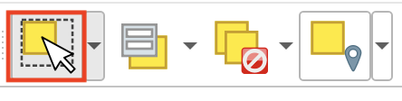

>*  Select downtown. 
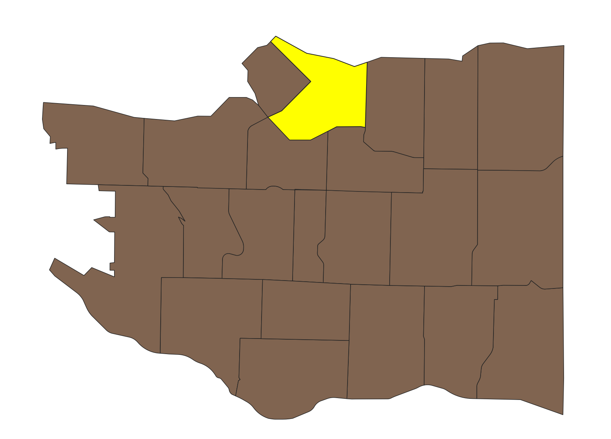

Note that you can also select multiple neighbourhoods by holding down the shift key on your computer while you select. 

Once you've made your selection, export it as a new file. Save your **selected features** to your project folder. You can do this by right-clicking your `neighbourhoods` layer in your **Layers Panel** and choosing **Export** **->** **Save Selected Features As...**. Save as a shapefile to your workshop folder. Name it `downtown` and change the CRS to match that of the project.  

In your **Layers Panel**, right-click your parks layer and choose **Export** **->** **Save Selected Features As...**.

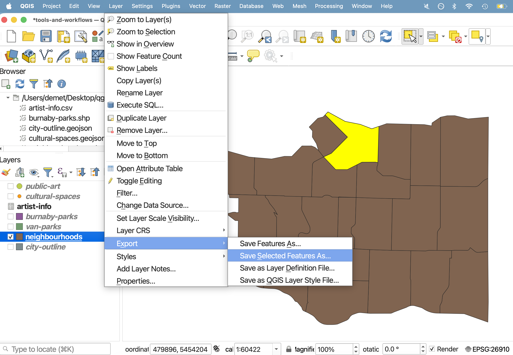

 

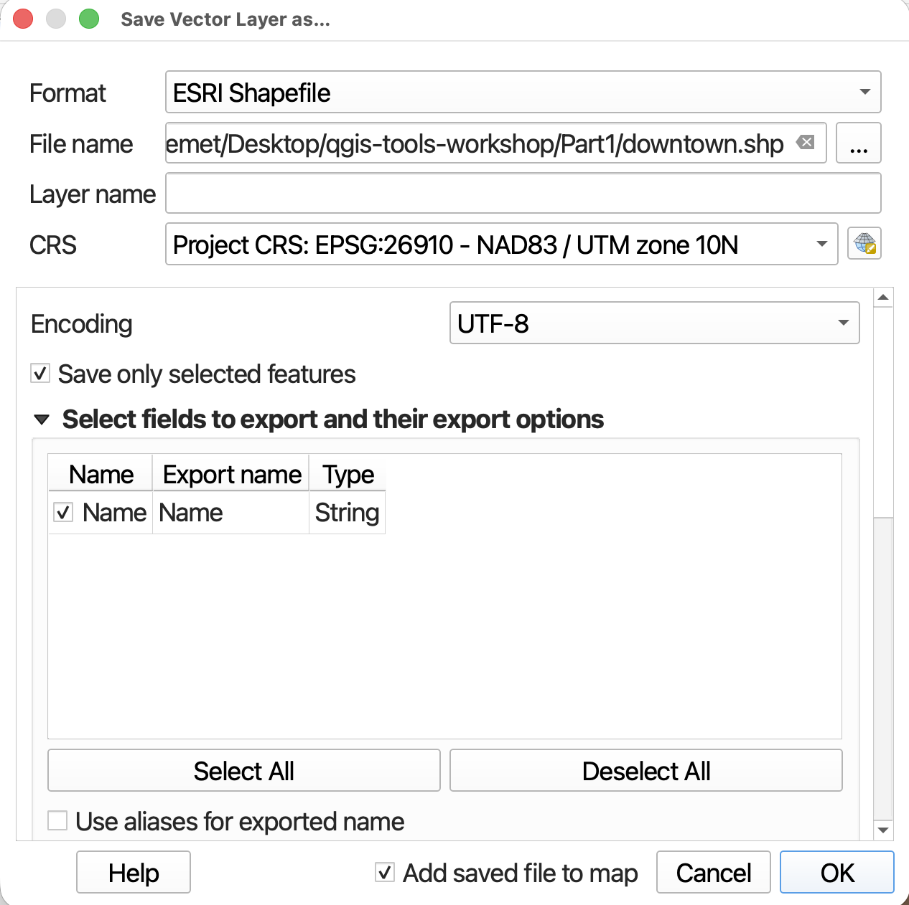

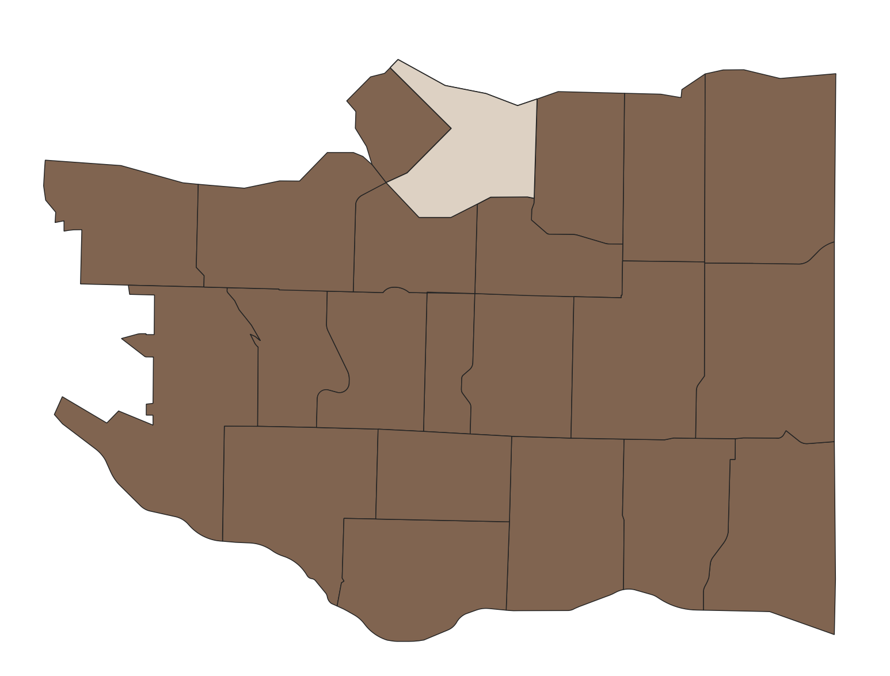
 

Click back to your `neighbourhoods` layer and make sure to unselect all features. 

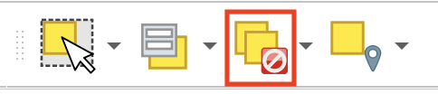

 

## Select by Expression 
If you didn't know just by looking which neighbourhood of Vancouver was downtown, you could write an expression to select it for you from the `neighbourhoods` layer. 

You can open the expression builder either by clicking the drop-down menu of the second selection tool, or from the layer Attribute Table. 

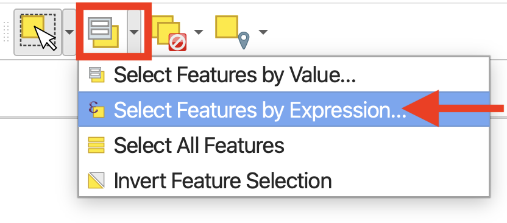

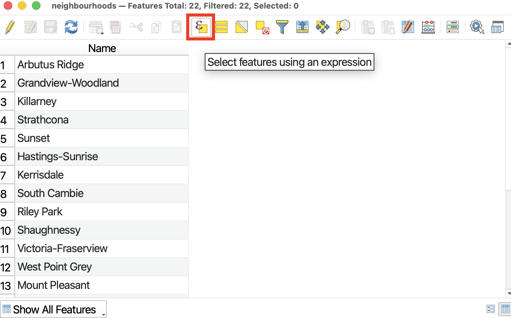

 

We want to write an expression that selects for the feature whose Name is equal to Downtown. 

Rather than writing an expression by hand, we will select the appropriate fields, values, and operators from the drop-downs provided. This ensures no syntax errors are made and our selection runs smoothly.

>* From the middle panel, expand **Fields and Values**. Double click on `Name` to add it to the Expression builder.

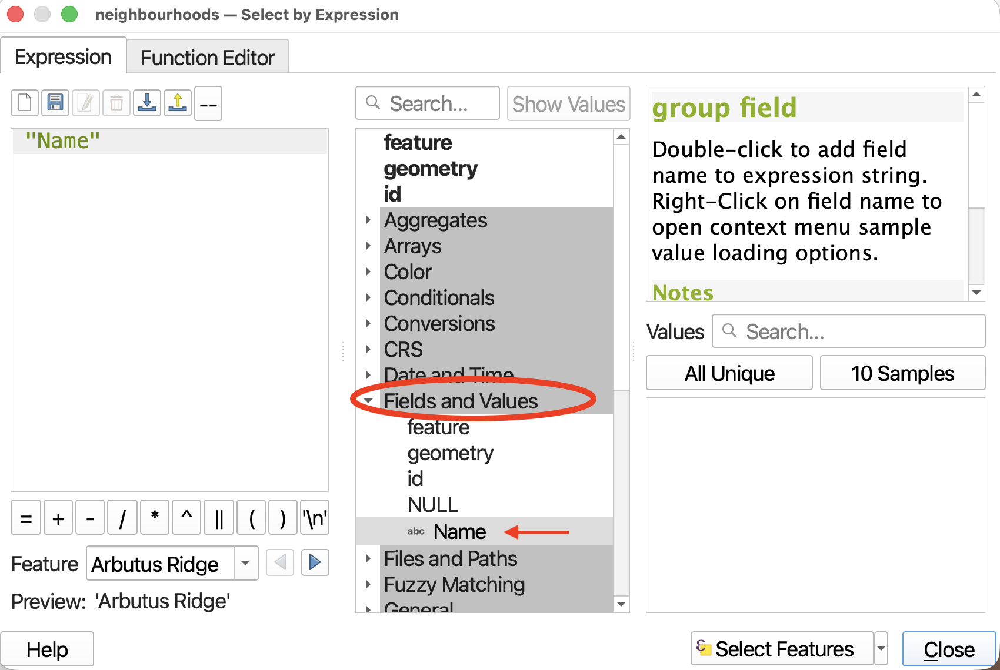
 
 

>* Then click the `=` operator. You will get a warning saying your expression is invalid. That’s okay! We aren’t finished building it.

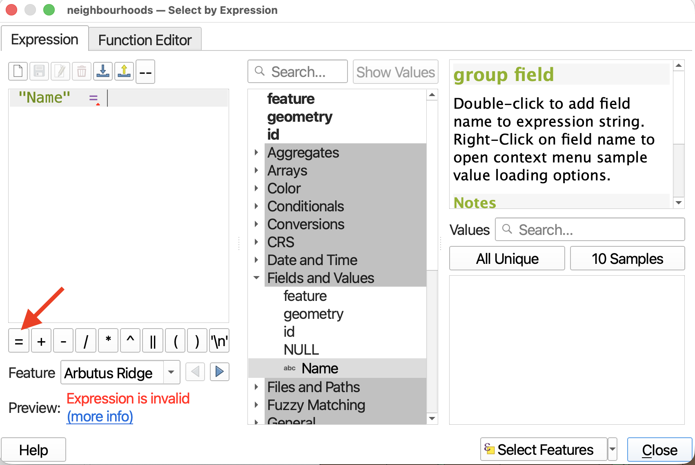
 
 

>* Finally, we need to indicate what the `Name` is equal to. In the right-hand panel, click the button for **All Unique** to display all the unique values for Name in the dataset. Double-click on “Downtown” to add it to the expression. Your expression should now be `"Name" = 'Downtown'`.

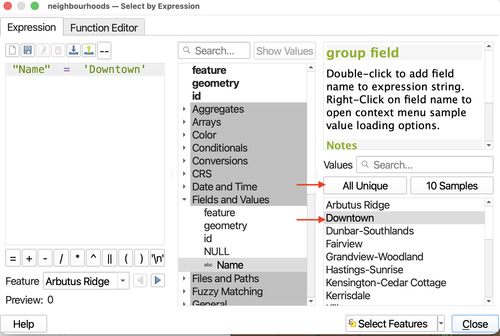
 
 

>* Now click **Select Features** and then close the expression builder. *Hide the layer for downtown you just created previously* and you should be able to see your selection worked just the same! 

 
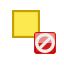  Remember to clear your selection, either in the Attribute Table or main QGIS interface. 

<!-- ### Clear selection
Clear your selection in the Attribute Table , close the Attribute Table, and return to the main QGIS interface. You can also clear your selection from the main QGIS Interface using the same icon from the main toolbar.  
 -->

 

## Spatial Selections
**[Select by location](https://docs.qgis.org/3.44/en/docs/user_manual/processing_algs/qgis/vectorselection.html#select-by-location){:target="_blank"}** allows you to select features in 1 layer based on their spatial relationship with those in another layer using various spatial operators. 

Slightly different than the above tool, **[Select within distance](https://docs.qgis.org/3.44/en/docs/user_manual/processing_algs/qgis/vectorselection.html#select-within-distance){:target="_blank"}** "creates a selection in a vector layer. Features are selected wherever they are within the specified maximum distance from the features in an additional reference layer" (QGIS).

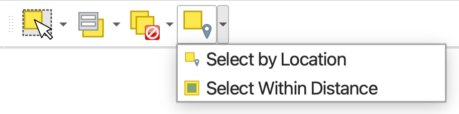
  

To Do
{: .label .label-green }

>* Use **Select by Location** to select all `cultural-spaces` located in downtown, using the *are within* geometric predicate. Use the layer for `downtown` you just created! 

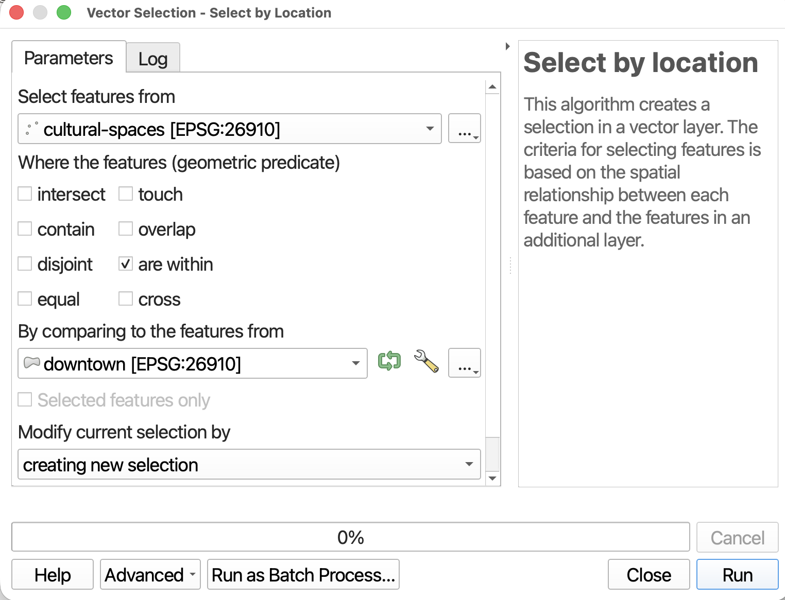
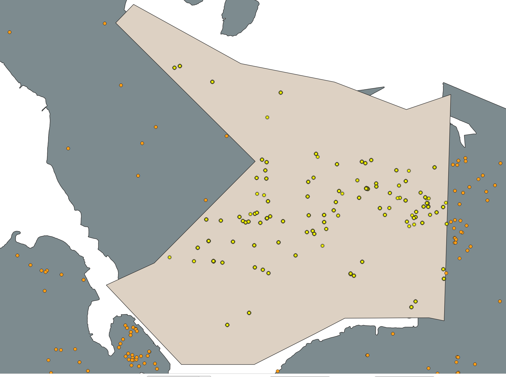
 
 

>* Use **Select within Distance** to select all `cultural-spaces` that are within 200 metres of a vancouver park. 

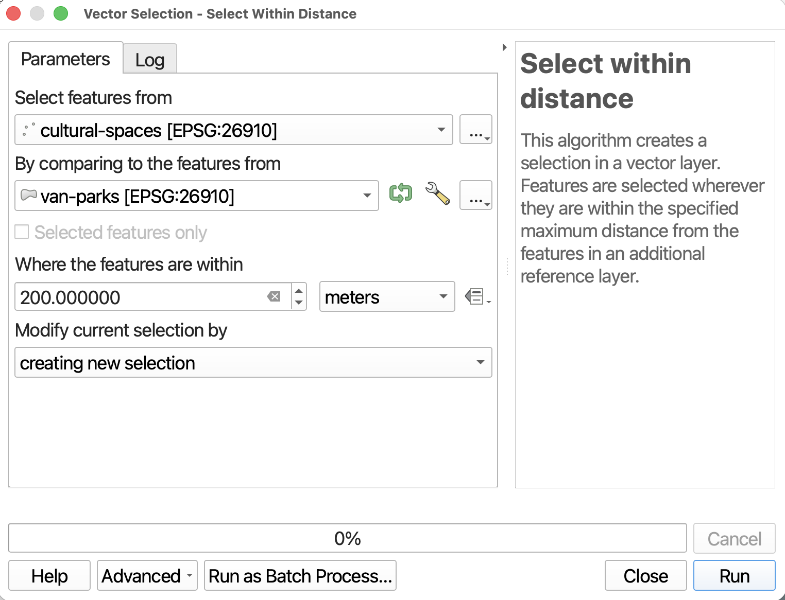
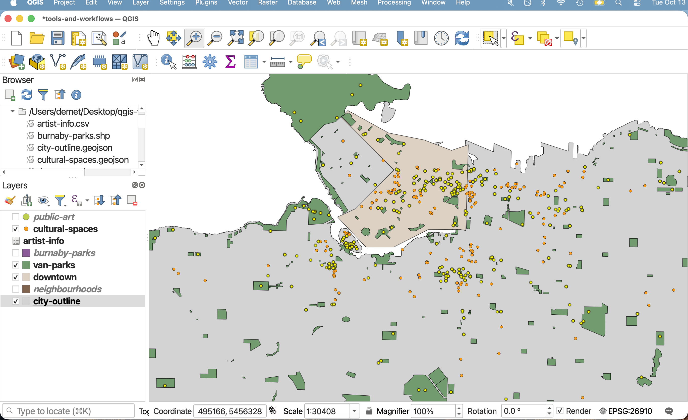
 
 

  Remember to clear your selection.

 

<!-- ## LAYERING SELECTION ETC. 

- You may select features by location using the Select by location vector analysis tool;

selection-toolbar
show selections toolbar

instead of soing select all that are xyz , could do select all that have area that is xyz   -->