# Vector Tools
This page will introduce some vector tools common in map making and spatial analysis. Vector tools can be searched for in the **Processing [Toolbox](https://docs.qgis.org/3.44/en/docs/user_manual/processing/toolbox.html){:target="_blank"}** which can be opened from the **Processing menu** at the top of your screen. They can also be accessed from the **Vector** menu, where they are grouped by task: Geoprocessing, Geometry, Analysis, Research, and Data Management. 

> Make sure your map canvas is zoomed to Vancouver and your curser is back on the **Pan tool**. 

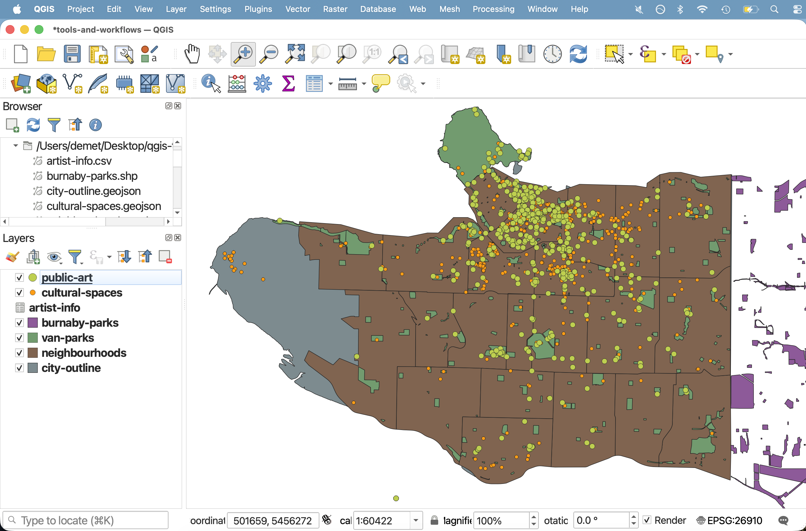

 

----

# Geoprocessing
Geoprocessing tools are useful for modifying the spatial extent of features, particularly in relationship to other layers. Geoprocessing is often done in the beginning of a QGIS project to prepare the data layers for further analysis. Indeed, the act of pre-processing data, essentially doing anything to get your project ready to run spatial analysis and/or create a map, is often just referred to as geoprocessing. The Geoprocessing tools we will introduce today are: **Clip**, **Buffer**, **Difference**, and **Dissolve**, and **Intersection**. 
<!-- , and **Union** -->

 

## Clip
The first tool we'll use is **[Clip](https://docs.qgis.org/3.44/en/docs/user_manual/processing_algs/qgis/vectoroverlay.html#clip){:target="_blank"}**, one of the most frequently used tools. Like a cookie cutter, Clip takes an Input layer (the cookie *dough*) and an Overlay layer (the cookie *cutter*), clipping the Input layer to the extent of the Overlay layer. Clip helps identify a set of points from a larger dataset within a particular area. It is a useful tool for highlighting a particular area of your map, honing your extent to certain area of interest. 

To Do
{: .label .label-green }
Let's clip `public-art` to `downtown`. 

> In the Processing Panel, search for "Clip". Make sure you open the tool under **Vector Overlay**.

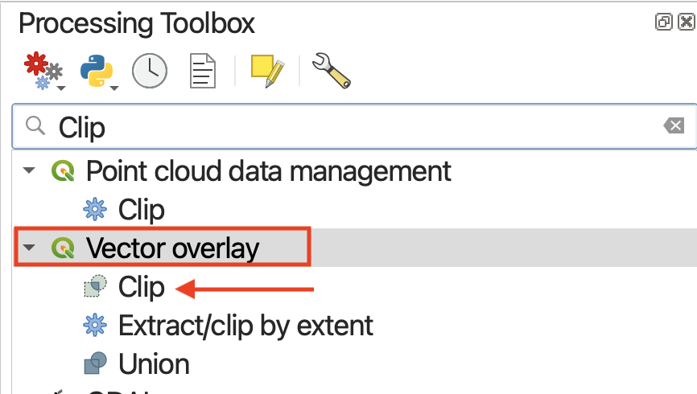

Clicking a tool will open a dialogue window specific to that tool. On the right hand side will be a description of what the tool does, and on the left, prompts for selecting input layers as well as saving the output layer to a file. 

> * Set `public-art` as your Input layer
> * Set `downtown` as your Overlay layer 

The choice to save the output layer as a **permanent** or **temporary** file depends on whether you are running an intermediary step in your workflow. Temporary files will be deleted when you quit your QGIS project, whereas permanent files are new datasets you saved and stored on your computer. Temporary layers load with the layer name of the tool — in this case, "Clip".

Since we're just practicing, we could leave the output as a temporary layer. However, since this will be a useful layer to have, let's save it as a permanent file before running by clicking "Save to file". Remember to give it a location (by clicking the tree dots `...`) as well as a name, such as `art_clip`. Save the output as a shapefile. 

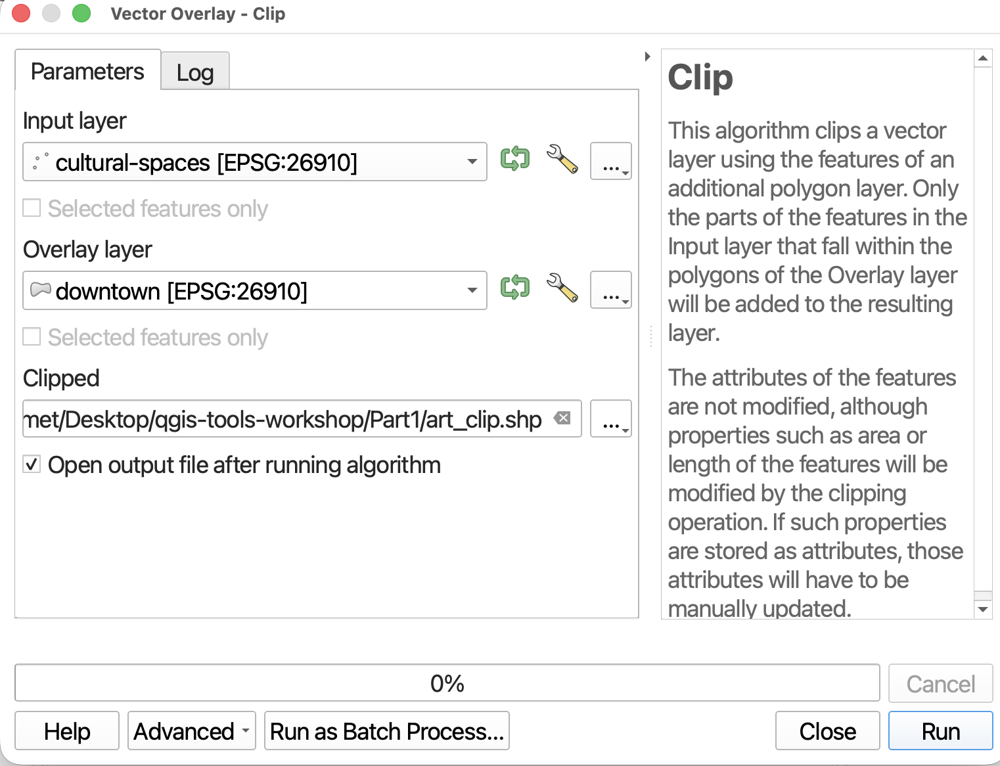

> * The tool window might disappear after setting the output filepath. Find the window again and click **Run**. Ignore any warning saying "No spatial index exists for the input layer"; this is how the data came from the City of Vancouver.  

> * Close the tool (it might have jumped behind your main QGIS interface), and return to your map view. Toggle off irrelevant layers for a moment so you can see the new Clip layer alone. 

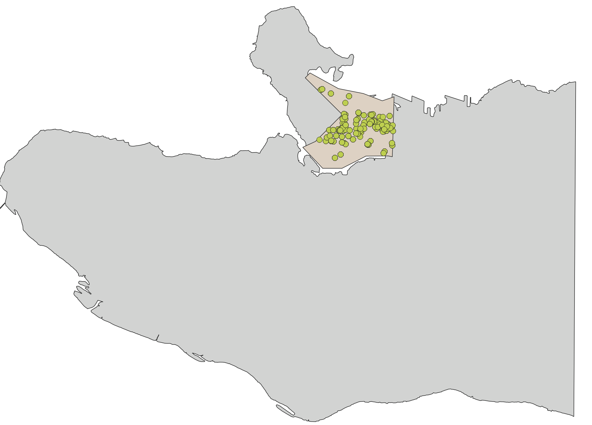

The attribute table will be the same. The only thing different is the number of features. 

Can you think of a different workflow to achieve the same result?
{: .note}

 

## Buffer
**[Buffer](https://docs.qgis.org/3.44/en/docs/gentle_gis_introduction/vector_spatial_analysis_buffers.html){:target="_blank"}** is probably the second most used/useful tool. Like the name implies, buffer creates a new layer that buffers a distance around points, lines, or polygons, and includes the area of the feature(s) buffered. Buffer is therefore useful for determining spatial proximity but defining a distance zone around features. For example, you could use Buffer areas prone to flooding around a water feature, or to determine a radio signal’s geographic influence or the area of a neighborhood disturbed by construction sounds.

To Do
{: .label .label-green }
Let's buffer `1 kilometer` around `cultural-spaces`. You can leave the output as a temporary layer. 

>* Find the Buffer tool under **Vector Geometry**.

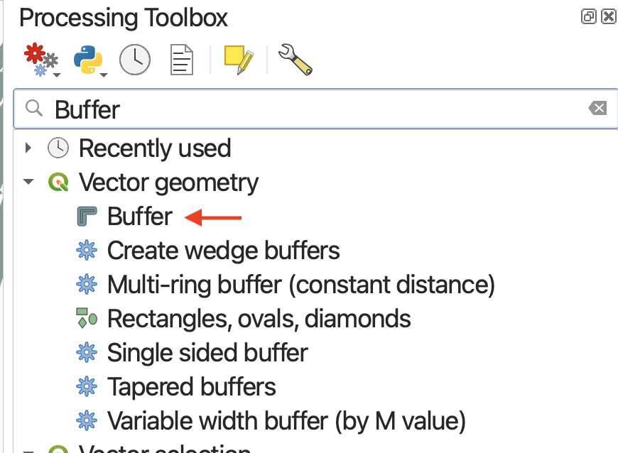

The Input Layer is the layer you want to buffer. 

 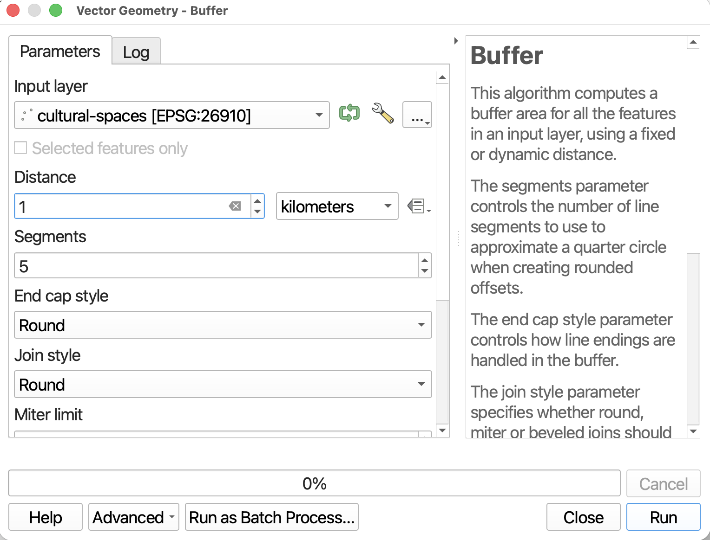

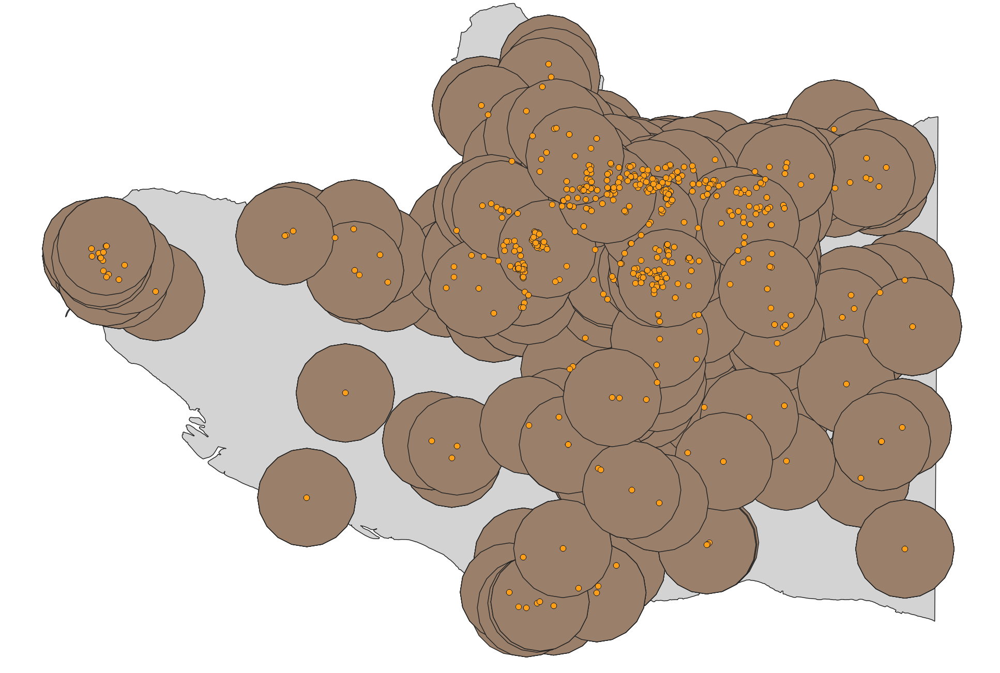

 

If we were only interested in the general area within 1 kilometer of a cultural center, we could scroll down and check the **Dissolve result** option before running the Buffer tool. The **Dissolve** option indicates whether or not you want the buffers of individual features to dissolve if they overlap. 

>* Run the buffer again on `cultural-spaces`, but this time check **Dissolve result**. The output will look like the image below. 

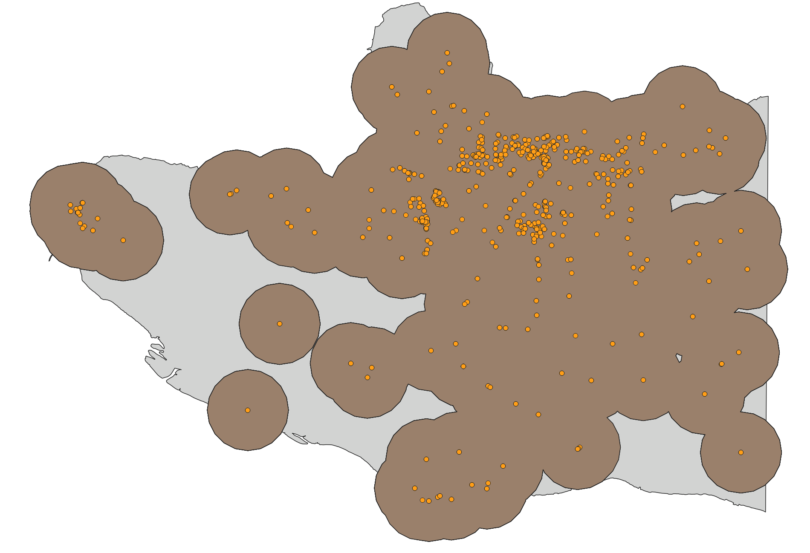

 

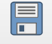 SAVE your project. 

 

There is also a stand-alone tool for dissolve. **[Dissolve](https://docs.qgis.org/3.44/en/docs/user_manual/processing_algs/qgis/vectorgeometry.html#dissolve){:target="_blank"}** takes multiple features within 1 layer and dissolves the boundaries between them. This is exactly what happened when we checked the Dissolve option on in the Buffer tool. 

Perhaps you don't want the lines of the neighbourhoods visible. You could run Dissolve to remove the differentiation between features; *however, as an important caveat, the resulting layer will no longer have distinct features in the attribute table*. 

How might you combine buffer and selections to find any parks that are not within 1 kilometer of a cultural center?
{: .note}

  

### Difference
**[Difference](https://docs.qgis.org/3.44/en/docs/user_manual/processing_algs/qgis/vectoroverlay.html#difference){:target="_blank"}** is like a spatial subtraction. Again, it will create a new layer so you don't have to worry about permanently altering your existing data (the correlate tool in ArcGIS, Erase, does just that). 

To Do
{: .label .label-green }

Let's find all areas of the city that are *not* parks. 

>* Find the Difference tool under **Vector Overlay**.

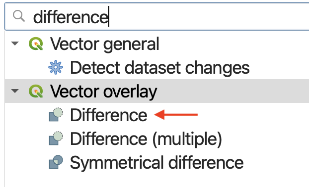

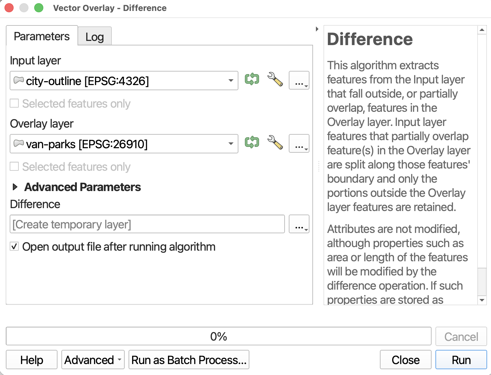

> Drag the output `Difference` to the top of your Layers panel, and uncheck extraneous layers. 

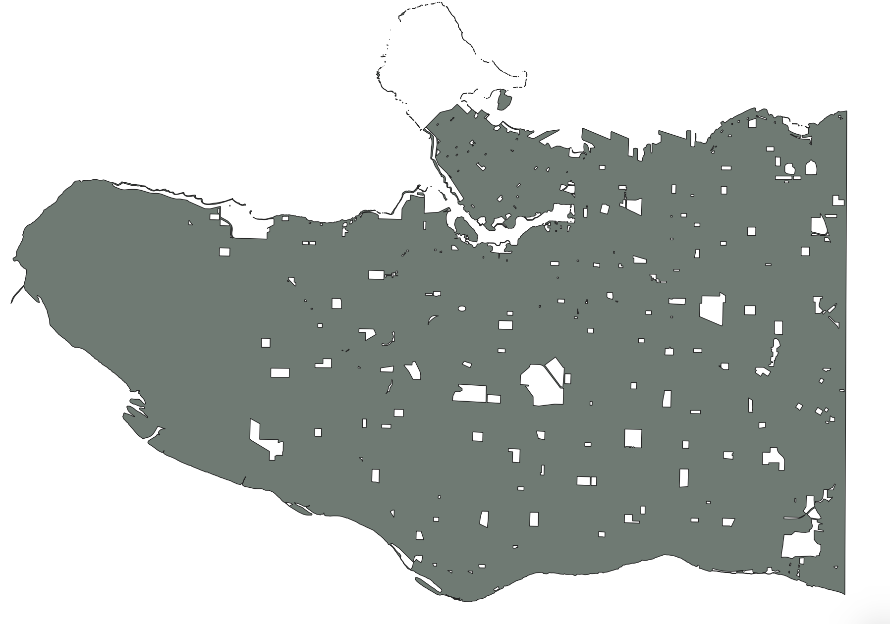
 

<!-- >* Just to practice, run the **Difference** tool to find areas that are within 500 meters of a cultural center, but are **not** parks. Your Input Layer will be `Buffered` and your Overlay Layer will be `van-parks`. It may help to rename the Buffered layer which was dissolved prior to running this tool.  -->

 

### Intersection
According to QGIS, **[Intersection](https://docs.qgis.org/3.44/en/docs/user_manual/processing_algs/qgis/vectoroverlay.html#intersection){:target="_blank"}** "Extracts the portions of features from the input layer that overlap features in the overlay layer." Additionally, attribute information is preserved and combined: "Features in the intersection layer are assigned the attributes of the overlapping features from both the input and overlay layers." 

How might you use Intersection and Buffer to find areas of the city that are within both 1km of a cultural center AND 1km of a public art? 
{: .note}

<!-- ### Union -->

  

## Data Management
Data Management tools is useful for modifying the data layer itself. The Data Management tools we will introduce today are: **Merge Vector Layers**, **Join Attributes by Location**, and **Reproject Layer**. 

 

## Merge
Writes QGIS: **[Merge](https://docs.qgis.org/3.44/en/docs/user_manual/processing_algs/qgis/vectorgeneral.html#merge-vector-layers){:target="_blank"}** "Combines multiple vector layers of the same geometry type into a single one." 

Merge can be a useful tool to manage your data. For example, we currently have 2 layers for parks: `van-parks` and `burnaby-parks`. To make life easier, we could just merge them all together into one layer. Because we are essentially combining datasets, the attribute table of the resulting layer would include the complete information for all parks. 

To Do
{: .label .label-green }

> * Open the **Merge Vector Layers** tool under **Vector general**.

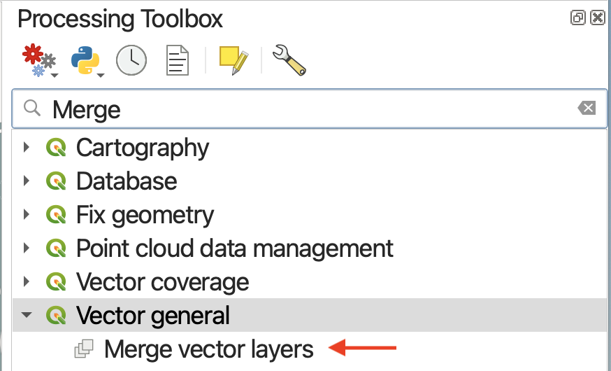

> * Click the three dots to choose your Input Layers. Select `van-parks` and `burnaby-parks`, then click the `<` arrow icon to return to the tool parameters. 

> * Set the Destination CRS to be that of the project. This only matters if your Input layers have different CRSs.

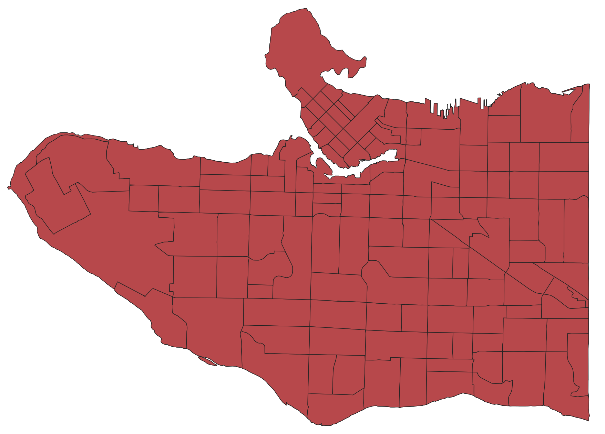

 

>* **Run** the tool and close it. Return to your Map Canvas and zoom-to the new `Merged` layer. Open the attribute table as well to confirm the success of your merge. 

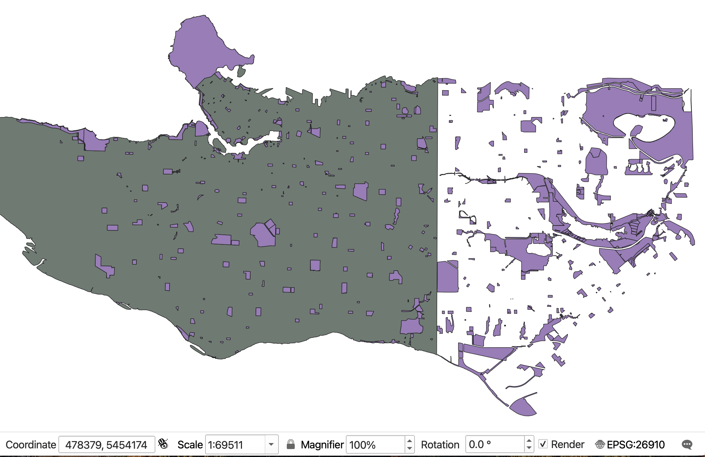

 
 

## Reproject Layer 
Reproject Layer takes the original layer, makes a copy of it and gives it a different projection. This is very useful if you have data stored in WGS 84 and you want to run distance calculations.

>* Search for the **Reproject Layer** tool.

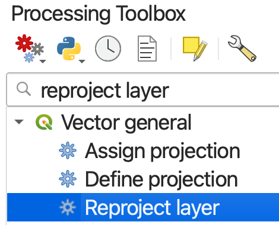

<!-- Join atts by location -->

